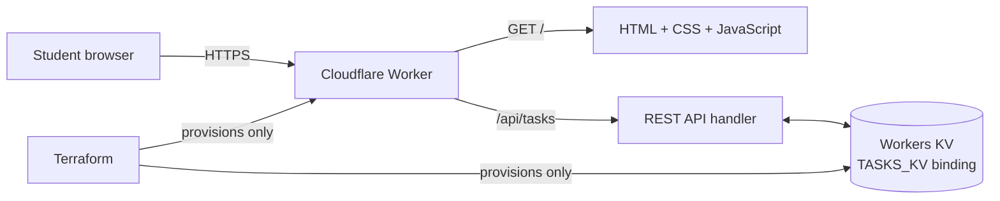
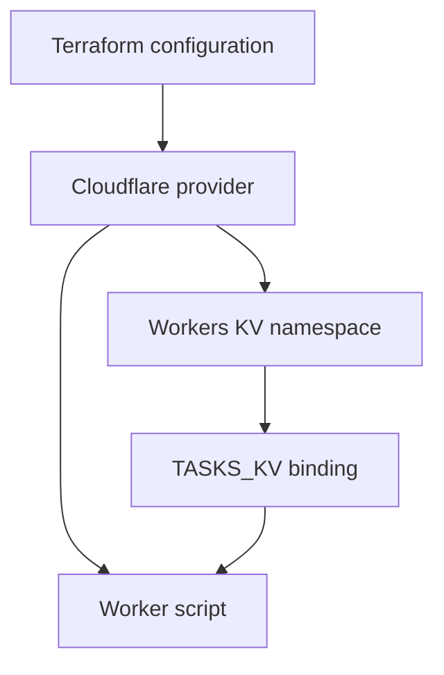
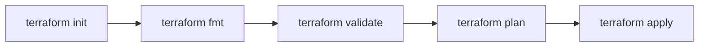
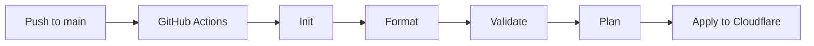
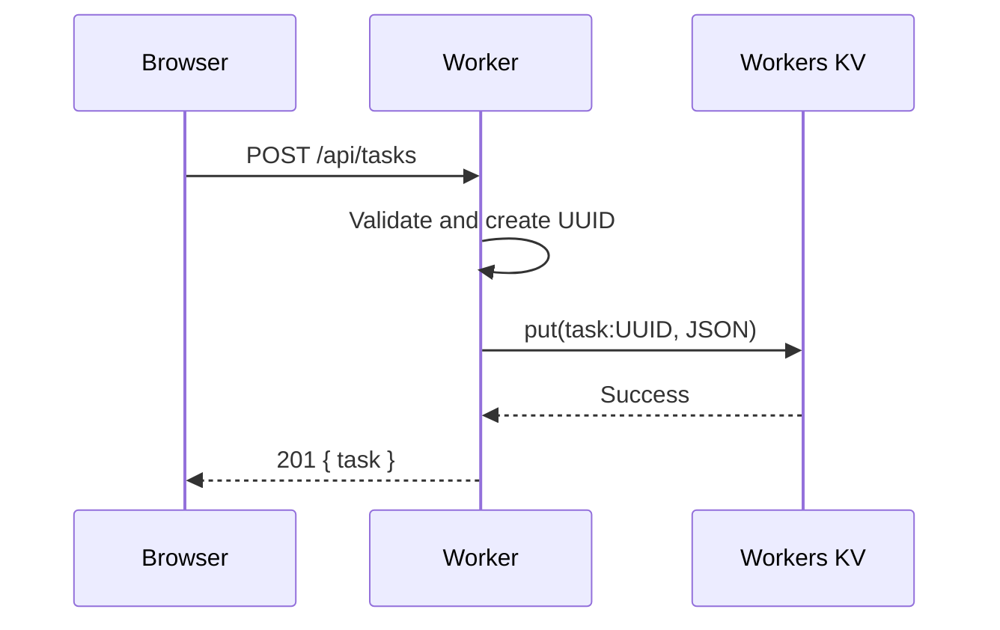

# Automated Deployment of a Serverless Student Task Management Application Using Terraform-Based Infrastructure as Code

TaskFlow is a serverless student task management application built for a Cloud Computing / Infrastructure as Code mini project. The browser UI is served by a Cloudflare Worker; the same Worker exposes a JSON REST API and stores all task records in Cloudflare Workers KV. Terraform is the only mechanism used to create Cloudflare resources.

## Project overview

Students can create, view, edit and delete cloud lab tasks, assignments and personal study work. Tasks persist across browser sessions and include an automatically generated ID, title, priority, status, created date, category and optional due date. The interface uses a polished Google Workspace-inspired light design with responsive glass cards, dashboard metrics, filters, search, status indicators, animation, modal forms, and accessible controls.

## System architecture



## Infrastructure flow



## Terraform workflow



## CI/CD pipeline



## Request flow



## Features

- Full CRUD task management with persistent Workers KV storage
- Automatic UUID task IDs and ISO created/updated timestamps
- Priority: Low, Medium, High; status: To Do, In Progress, Completed
- Due dates, categories, text search, priority/status filtering and client-side sorting
- Live dashboard cards and circular completion statistic
- Responsive Material-inspired glassmorphism UI, modal validation, toasts, loading state and keyboard-friendly HTML
- JSON API error responses, input validation and safe HTTP headers
- Terraform-managed Worker, KV namespace and `TASKS_KV` binding

## Technologies

| Layer | Technology |
|---|---|
| Frontend | HTML5, CSS3, modern JavaScript |
| Backend | Cloudflare Worker (JavaScript) |
| Database | Cloudflare Workers KV |
| Infrastructure | Terraform + Cloudflare provider |
| Automation | GitHub Actions |
| Version control | Git |

## Installation and Cloudflare setup

1. Install Terraform 1.5+ and Git.
2. Create a Cloudflare account and copy its Account ID from the dashboard.
3. Create an API token with Account-level **Workers Scripts: Edit** and **Workers KV Storage: Edit** permissions.
4. Set the token locally and configure Terraform:

```powershell
cd terraform
$env:CLOUDFLARE_API_TOKEN = "replace-with-token"
Copy-Item terraform.tfvars.example terraform.tfvars
# Edit terraform.tfvars and set account_id.
terraform init
terraform fmt
terraform validate
terraform plan
terraform apply
```

The Worker URL output uses a placeholder for your workers.dev subdomain. Enable a workers.dev subdomain in Cloudflare if your account has not done so, then open `https://<worker-name>-<environment>.<your-subdomain>.workers.dev`.

## Terraform commands

```powershell
cd terraform
terraform init
terraform fmt
terraform validate
terraform plan
terraform apply
terraform destroy
```

All Cloudflare infrastructure must remain Terraform-managed. Do not manually create a Worker, KV namespace, or binding in the Cloudflare dashboard.

## GitHub Actions setup

In GitHub, open **Repository → Settings → Secrets and variables → Actions** and add:

| Secret | Value |
|---|---|
| `CLOUDFLARE_API_TOKEN` | The Cloudflare API token |
| `CLOUDFLARE_ACCOUNT_ID` | Cloudflare account ID |

Push to the `main` branch. The workflow initializes, formats, validates, plans and applies Terraform. For a real team project, use protected branches and a reviewed plan/apply approval environment before enabling automatic production applies.

## REST API documentation

Base URL: `https://<worker-url>/api/tasks`

| Method | Endpoint | Success | Description |
|---|---|---:|---|
| POST | `/api/tasks` | 201 | Create a task |
| GET | `/api/tasks` | 200 | List tasks; accepts `?sort=createdAt:desc` |
| GET | `/api/tasks/:id` | 200 | Get one task |
| PUT | `/api/tasks/:id` | 200 | Update a task |
| DELETE | `/api/tasks/:id` | 204 | Delete a task |

Create/update body:

```json
{
  "title": "Complete Terraform lab report",
  "priority": "High",
  "status": "In Progress",
  "category": "Cloud Lab",
  "dueDate": "2026-10-01"
}
```

Invalid input returns `400`, missing tasks return `404`, unsupported routes/methods return `404`/`405`, and unexpected server errors return `500`.

## Screenshots

Place captured application screenshots in [`screenshots/`](screenshots/). Suggested evidence for the final report:

- Dashboard with statistics and task list
- Add Task modal and validation
- Filtered / searched tasks
- Terraform apply output and Cloudflare Worker overview
- Successful GitHub Actions workflow run

## Future scope

- Cloudflare Access authentication and per-student namespaces
- Task notes, attachments and recurring tasks
- Durable Objects for collaborative real-time task lists
- Pagination / secondary index strategy for large KV collections
- Separate staging and production Terraform state with remote state controls

See [setup.md](setup.md) for the required lab procedure and [terraform/README.md](terraform/README.md) for infrastructure-specific notes.

